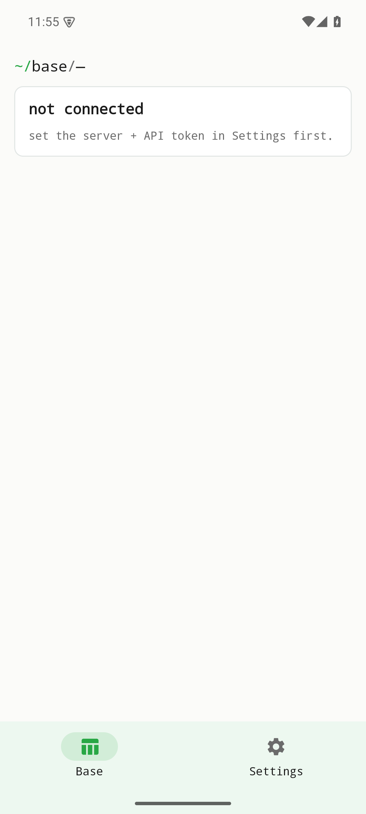
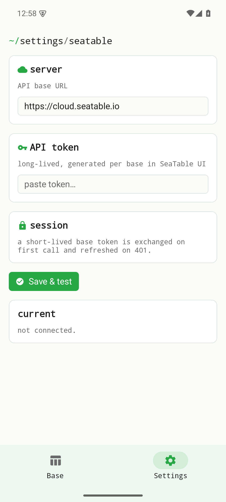

Eine SeaTable-Base, ihre Tabellen und die ersten 100 Zeilen mit einem Base-API-Token ansehen. Zellenbearbeitung und Seitennavigation sind nicht verfügbar. Bei einem Autorisierungsfehler wird der Zugriffstoken einmal erneuert.

Diese Seite beschreibt den Quellstand vom Oktober 2026. Die Änderungen sind unveröffentlicht und nicht Teil älterer Entwicklungsreleases. Lokale Prüfungen ersetzen keine Geräte-, Live-Server- oder Store-Abnahme.

[Current status / Aktueller Stand / État actuel](../current-status.qmd)

Historische Bildschirmfotos aus v0.1.0; sie belegen keine Prüfung des aktuellen Quellstands.

{width=320}

{width=320}
