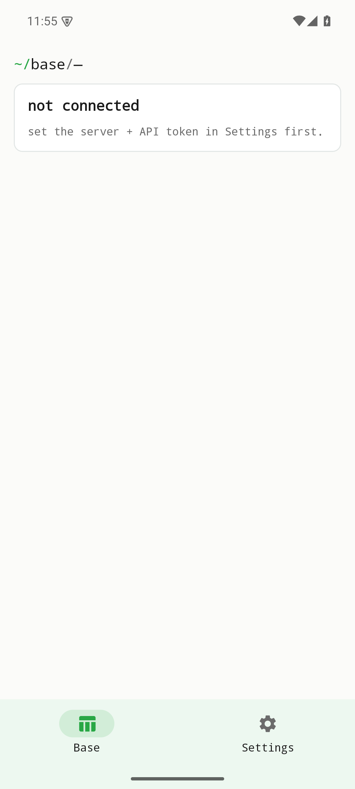
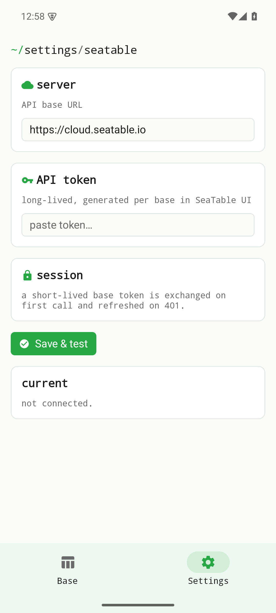

Browse a SeaTable base, its tables and the first 100 rows using a base API token. Cell editing and pagination are unavailable. Tokens are refreshed once on authorization failure.

This page describes the October 2026 source revision. These changes are unpublished and are not part of older development releases. Local checks are distinct from device, live-service and store acceptance.

[Current status / Aktueller Stand / État actuel](../current-status.qmd)

Historical screenshots from v0.1.0; these are not verification of the current revision.

{width=320}

{width=320}
