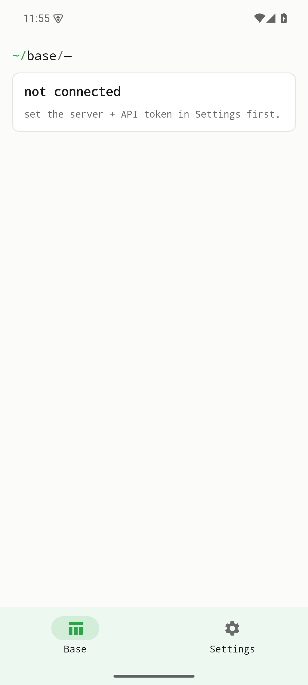
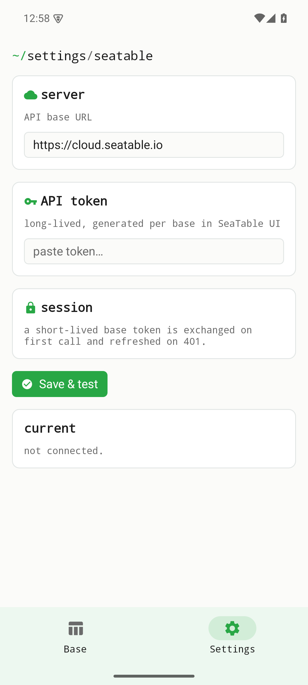

Consulter une base SeaTable, ses tables et les 100 premières lignes avec un jeton API de base. La modification des cellules et la pagination ne sont pas disponibles. Le jeton d’accès est renouvelé une fois en cas d’échec d’autorisation.

Cette page décrit les sources d’octobre 2026. Ces modifications ne sont pas publiées et ne figurent pas dans les anciennes versions de développement. Les contrôles locaux ne remplacent pas la validation sur appareil, serveur réel ou boutique.

[Current status / Aktueller Stand / État actuel](../current-status.qmd)

Captures historiques de v0.1.0 ; elles ne constituent pas une validation de la version actuelle.

{width=320}

{width=320}
